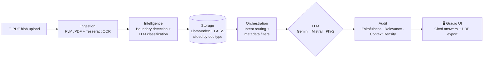

# 🤖 AI-Powered Document Automation Platform (MVP)
### Turning messy, multi-document PDFs into answers you can verify

**🏆 Top Performer Award (Top 10%)** · Outamation AI-Powered Document Insights & Data Extraction Externship · Oct 2025 – Jan 2026

---

## Contents
[TL;DR](#tldr) · [The Problem](#the-problem) · [The Product](#the-product) · [Key Product Decisions](#key-product-decisions) · [Architecture](#architecture) · [Demos](#demos) · [Evaluation](#evaluation--evidence) · [Delivery: 9 Sprints](#delivery-9-sprints) · [Tech Stack](#tech-stack) · [My Role](#my-role)

---

## TL;DR

| | |
|---|---|
| **Users** | Loan officers and operations teams who process high-volume documents (mortgage, finance, legal, HR) |
| **Problem** | Bulk-scanned PDFs mix many document types. Standard RAG blends them together and returns answers from the wrong document. |
| **Solution** | Detects where each document begins and ends, classifies it, stores each type in its own search "silo," and answers with page-level citations. |
| **Proof** | Quality audit on every answer (Faithfulness, Relevance, Context Density), PDF audit export, and 3 swappable LLMs |
| **Outcome** | Working MVP + live POC · 🏆 Top Performer Award (Top 10%) |

---

## The Problem

Companies process thousands of unstructured documents every day, such as loan applications, pay slips, contracts, and fee sheets. They're often scanned together into one large PDF "blob." That creates three problems:

1. **Context contamination.** Generic RAG treats the blob as one stream of text, so a question about a pay slip can pull numbers from a contract.
2. **Manual prep work.** Someone has to split and label files before any tool can use them.
3. **No trust trail.** In finance and legal work, an answer without a source can't be used. Teams need to see *where* every number came from.

---

## The Product

A three-tab Gradio app built for the person who has to act on the answer:

| Tab | What the user does |
|---|---|
| **💬 Chat Operations** | Upload a PDF, pick a model (Gemini 2.0 Flash, Mistral 7B, or Phi-2), ask questions, or use one-click prompts like **Summarize** and **Find Amounts**. Every answer cites its source (e.g., *Invoice, p. 4*). Export the session as a PDF audit trail. |
| **⚙️ Configuration & Filters** | View the document structure as JSON, adjust chunk size and overlap, and filter retrieval to a single document type (e.g., only *Lender Fee Sheets*). |
| **📊 Performance Audit** | Review Faithfulness, Relevance, Context Density, and latency for each query to see why an answer did or didn't perform well. |

---

## Key Product Decisions

| Decision | Why | Trade-off |
|---|---|---|
| **Silo the vector store by document type** | Stops answers from mixing documents, which is the #1 failure in mixed-document RAG | Requires an accurate classification step up front |
| **Hybrid extraction: LLM + deterministic regex** | Financial figures must be exact. The LLM interprets *what* a fee is; regex captures the exact number. | More logic to maintain than pure-LLM extraction |
| **Page-level citations on every answer** | A human must be able to verify before acting (human-in-the-loop) | Ingestion must preserve page and layout metadata |
| **Three swappable models (API + local)** | Gives a choice of reasoning quality, speed, cost, and data-privacy needs | Local models need careful GPU memory management (built a "deep purge" safety gate for T4 GPUs) |
| **Model-aware retrieval** | Smaller models need more help: Phi-2 retrieves 8 chunks instead of 5 | Larger prompts and slightly higher latency |
| **Audit gate + PDF export** | Regulated teams need a paper trail, not a black box | Adds processing time to each response |

---

## Architecture

| Layer | What it does |
|---|---|
| **Ingestion** | Hybrid OCR extracts text and images while preserving page layout metadata |
| **Intelligence** | Classifies pages into a business taxonomy (Invoices, Land Deeds, Pay Slips…) and detects document boundaries |
| **Storage** | Separate, metadata-filtered silos so document types never leak into each other |
| **Orchestration** | A generator-based loop that streams status updates and manages GPU state safely |
| **Audit** | Scores each answer on the RAG Triad and tracks performance |
| **Presentation** | Gradio UI with live PDF preview, citations, and exportable audit reports |

---

## Demos

| Demo | What it shows | Video |
|---|---|---|
| UI Walkthrough | All three tabs and the overall design | [▶️ Watch](https://youtu.be/T4zju8HCFMM) |
| Gemini: Ingestion & One-Click Prompts | Boundary detection, document viewer, Summarize and Find Amounts | [▶️ Watch](https://youtu.be/FG8nZZfnJ78) |
| Export Chat History as PDF | Audit trail with model, citations, and timestamps | [▶️ Watch](https://youtu.be/JwXRt7PwbmE) |
| Switch to Mistral | Model swap + ingestion + prompts | [▶️ Watch](https://youtu.be/_qzGlJbhN5U) |
| Switch to Phi-2 (local) | Lightweight local model on a T4 GPU with VRAM safety gate | [▶️ Watch](https://youtu.be/KewimB_I_k8) |
| RAG Config, JSON & Doc-Type Filter | Siloed retrieval and metadata transparency | [▶️ Watch](https://youtu.be/rNTbHpflirk) |

📖 Full write-ups: [DEMO.md](https://github.com/LashawnFofung/AI-Powered-Document-Automation-Platform/blob/main/DEMO/DEMO.md) · 🌐 [Try the live POC](https://huggingface.co/spaces/lfofung/AI-Powered-Document-Intelligence-Automation-Platform)

---

## Evaluation & Evidence

Model choices were benchmarked, not guessed:

- **[Embedding Model Scorecard](https://github.com/LashawnFofung/AI-Powered-Document-Automation-Platform/blob/main/Technical%20Evaluation%20Reports/Embedding%20Model%20Scorecard%20Analysis.pdf)** — MiniLM-L6-v2 vs. BGE-small-en vs. E5-small-v2 on indexing speed, retrieval speed, and retrieval quality.
- **[Comparative Analysis of LLMs for RAG](https://github.com/LashawnFofung/AI-Powered-Document-Automation-Platform/blob/main/Technical%20Evaluation%20Reports/Comparative%20Analysis%20of%20Large%20Language%20Models%20%20for%20Retrieval-Augmented%20Generation%20%28RAG%29.pdf)** — LLM and embedding combinations tested for sub-second retrieval with factual accuracy.
- **OCR engine comparison (Sprint 4)** — Tesseract vs. PaddleOCR vs. EasyOCR for layout-aware extraction from scanned documents.
- **Built-in quality audit** — every live answer is scored on Faithfulness, Relevance, and Context Density.

---

## Delivery: 9 Sprints

Built across nine sprints, with a written status update for each.

| Sprint | Focus | Artifacts |
|---|---|---|
| **S1** | Problem framing & core objectives | [Status](https://github.com/LashawnFofung/AI-Powered-Document-Automation-Platform/blob/main/Status%20Updates/Status%20Update%20Sprint%201%20AI-Powered%20Document%20Automation%20Platform.pdf) |
| **S2** | Data prep: cleaning, standardization, and image processing for mortgage documents | [Status](https://github.com/LashawnFofung/AI-Powered-Document-Automation-Platform/blob/main/Status%20Updates/Status%20Update%20Sprint%202%20AI-Powered%20Document%20Automation%20Platform-2.pdf) |
| **S3** | Field extraction from digital and scanned PDFs (PyMuPDF, pdfplumber, regex, anchor phrases) | [Status](https://github.com/LashawnFofung/AI-Powered-Document-Automation-Platform/blob/main/Status%20Updates/Status%20Update%20Sprint%203%20AI-Powered%20Document%20Automation%20Platform.pdf) |
| **S4** | OCR evaluation: Tesseract vs. PaddleOCR vs. EasyOCR | [Status](https://github.com/LashawnFofung/AI-Powered-Document-Automation-Platform/blob/main/Status%20Updates/Status%20Update%20Sprint%204%20AI-Powered%20Document%20Automation%20Platform.pdf) |
| **S5** | First RAG pipeline with LlamaIndex | [Status](https://github.com/LashawnFofung/AI-Powered-Document-Automation-Platform/blob/main/Status%20Updates/Status%20Update%20Sprint%205%20AI-Powered%20Document%20Automation%20Platform.pdf) |
| **S6** | RAG optimization: chunking, metadata filtering, open-source LLMs (Mistral, Phi-2) | [Status](https://github.com/LashawnFofung/AI-Powered-Document-Automation-Platform/blob/main/Status%20Updates/Status%20Update%20Sprint%206%20AI-Powered%20Document%20Automation%20Platform.pdf) · [Embedding Report](https://github.com/LashawnFofung/AI-Powered-Document-Automation-Platform/blob/main/Technical%20Evaluation%20Reports/Embedding%20Model%20Scorecard%20Analysis.pdf) · [LLM Report](https://github.com/LashawnFofung/AI-Powered-Document-Automation-Platform/blob/main/Technical%20Evaluation%20Reports/Comparative%20Analysis%20of%20Large%20Language%20Models%20%20for%20Retrieval-Augmented%20Generation%20%28RAG%29.pdf) |
| **S7** | Blob processing: automatic splitting, classification, and routing | [Status](https://github.com/LashawnFofung/AI-Powered-Document-Automation-Platform/blob/main/Status%20Updates/Status%20Update%20Sprint%207%20AI-Powered%20Document%20Automation%20Platform.pdf) |
| **S8** | Interactive Gradio chatbot + proof of concept | [Status](https://github.com/LashawnFofung/AI-Powered-Document-Automation-Platform/blob/main/Status%20Updates/Status%20Update%20Sprint%208%20AI-Powered%20Document%20Automation%20Platform.pdf) · [Chatbot Notebook](https://github.com/LashawnFofung/RAG-Pipelines/blob/main/Gradio/Task_Full_RAG_Pipeline_with_Interactive_Gradio_Chatbot.ipynb) · [Chatbot Deck](https://github.com/LashawnFofung/RAG-Pipelines/blob/main/Presentation/Full%20RAG%20Pipeline%20with%20Interactive%20Gradio%20Chatbot%20-%20Demo%20and%20Reflection.pdf) · [POC Notebook](https://github.com/LashawnFofung/RAG-Pipelines/blob/main/POC/Task_Enhanced_Document_Q%26A_System_with_Intelligent_RAG_Pipeline.ipynb) · [POC Deck](https://github.com/LashawnFofung/RAG-Pipelines/blob/main/Presentation/AI-Powered%20Document%20Intelligence%20Automation%20Platform%20with%20Gradio%20Chatbot%20-%20Demo%20and%20Reflection.pdf) · [Live POC](https://huggingface.co/spaces/lfofung/AI-Powered-Document-Intelligence-Automation-Platform) |
| **S9** | Final integration, testing, and MVP | [Status](https://github.com/LashawnFofung/AI-Powered-Document-Automation-Platform/blob/main/Status%20Updates/Status%20Update%20Sprint%209%20%20AI-Powered%20Document%20Automation%20Platform.pdf) · [MVP Notebook](https://github.com/LashawnFofung/AI-Powered-Document-Automation-Platform/blob/main/src/AI_Powered_Document_Intelligence_Automation_Platform_MVP.ipynb) · [Demos](https://github.com/LashawnFofung/AI-Powered-Document-Automation-Platform/blob/main/DEMO/DEMO.md) |

---

## Tech Stack

**Orchestration & retrieval:** LlamaIndex · FAISS · metadata filtering · intent routing
**Models:** Gemini 2.0 Flash (API) · Mistral 7B (local) · Phi-2 (local)
**Document processing:** PyMuPDF · Tesseract OCR · pdfplumber · regex extraction
**Interface:** Gradio (custom theme, live PDF preview, PDF export)
**Environment:** Python 3 · Google Colab (T4 GPU) · Hugging Face Spaces

---

## My Role

I built this platform end to end during the externship, working as both product owner and builder:

- **Scoped the MVP** around one core user risk: answers pulled from the wrong document.
- **Ran the evaluations** (OCR engines, embedding models, LLMs) and used the results to choose the stack.
- **Built the pipeline and UI** — ingestion, classification, siloed retrieval, audit metrics, and the Gradio app.
- **Reported progress each sprint** with written status updates for stakeholders.
- **Delivered** a working MVP, a live POC, six demo videos, and two technical evaluation reports.

---

## Related Repos

- [Python Document Preparation & Extraction](https://github.com/LashawnFofung/Python-Document-Preparation-and-Extraction) — the data-prep and extraction groundwork
- [RAG Pipelines](https://github.com/LashawnFofung/RAG-Pipelines) — step-by-step builds from a basic chatbot to the production-style POC
- [🏆 Award](https://github.com/LashawnFofung/AI-Powered-Document-Automation-Platform/tree/main/Awards) · [AI Portfolio](https://github.com/LashawnFofung/AI-Portfolio) · [MBA Portfolio](https://github.com/LashawnFofung/MBA-IT-Management-Portfolio)

**Lashawn Fofung** · Technical Product Manager · [LinkedIn](https://www.linkedin.com/in/lashawnfofung/)

